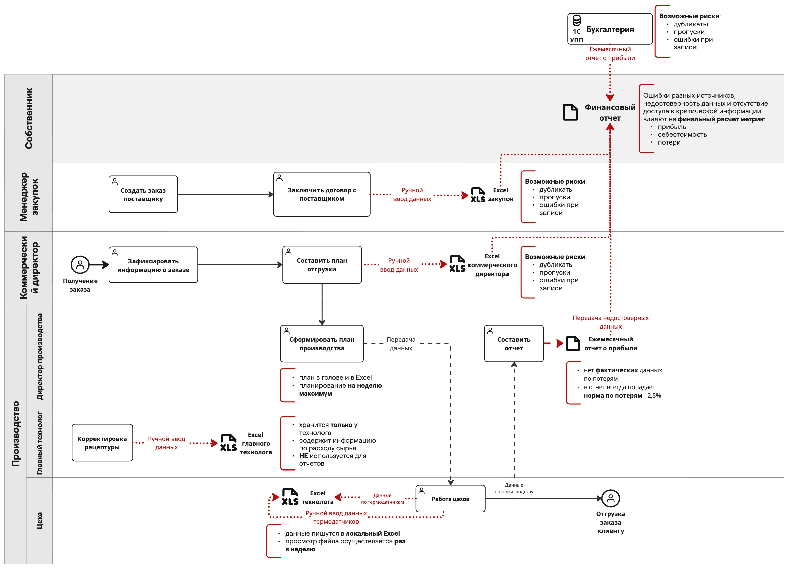
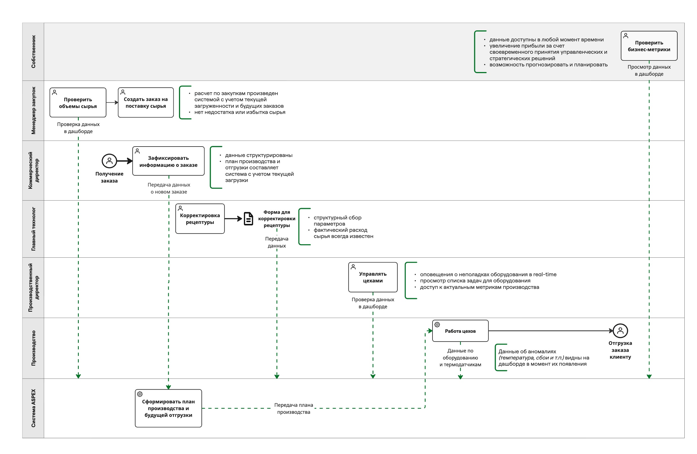
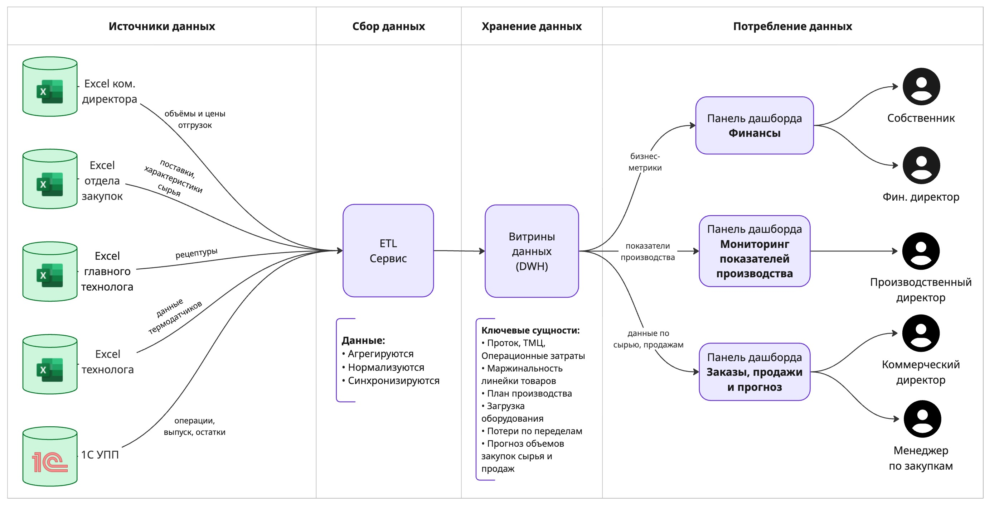

# 04. AS-IS, TO-BE и схема источников данных

## AS-IS: как сейчас работает процесс сбора данных и принятия решений

Автор: BA (Костюнина Р.С.).

**Участники (дорожки):** собственник; менеджер закупок; коммерческий директор; производство (директор производства, главный технолог, цеха).

**Системы и источники данных:** 1С УПП; Excel закупок; Excel коммерческого директора; Excel главного технолога; Excel технолога.

**Объекты процесса:** получение заказа; финансовый отчёт; ежемесячный отчёт о прибыли.

**Проблемные потоки** (на схеме выделены красным пунктиром):

- ручной ввод данных термодатчиков;
- данные по термодатчикам передаются через локальный Excel;
- ручной ввод данных в нескольких точках процесса;
- ежемесячный отчёт о прибыли формируется из 1С УПП;
- передача недостоверных данных.

## TO-BE: как должен работать процесс

Автор: BA (Малова Ю.А.).

**Участники (дорожки):** собственник; менеджер закупок; коммерческий директор; главный технолог; производственный директор; производство; система ASPEX.

**Ключевые изменения:**

- коммерческий директор передаёт данные о новом заказе в систему;
- система передаёт план производства в производство;
- у главного технолога появляется форма для корректировки рецептуры;
- данные собираются в одной системе вместо разрозненных Excel-файлов.

## Схема систем и источников данных

Автор: BA (Костюнина Р.С.).

**Источники данных:**

- 1С УПП
- Excel технолога (данные по термодатчикам)
- Excel главного технолога
- Excel отдела закупок
- Excel коммерческого директора

**Потоки данных на схеме:** бизнес-метрики; показатели производства; данные по сырью и продажам.

**Потребители:** панели дашборда по ролям. На схеме, например, панель «Заказы, продажи и прогноз» и роли менеджера по закупкам и коммерческого директора.
